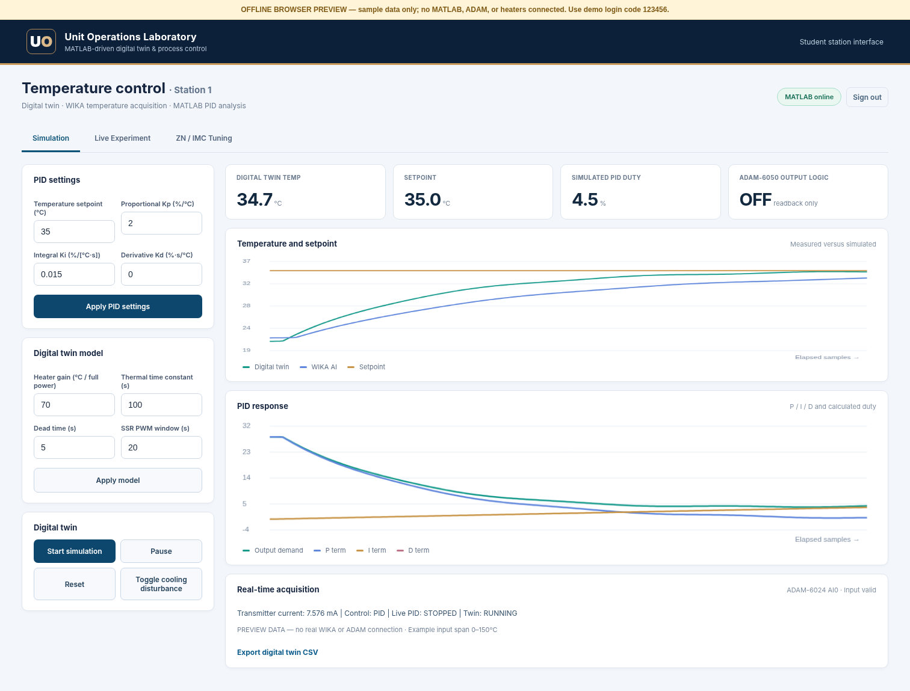
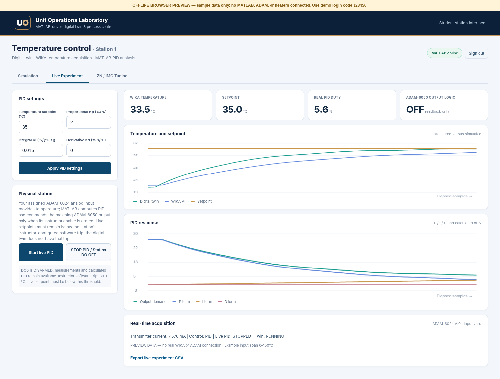
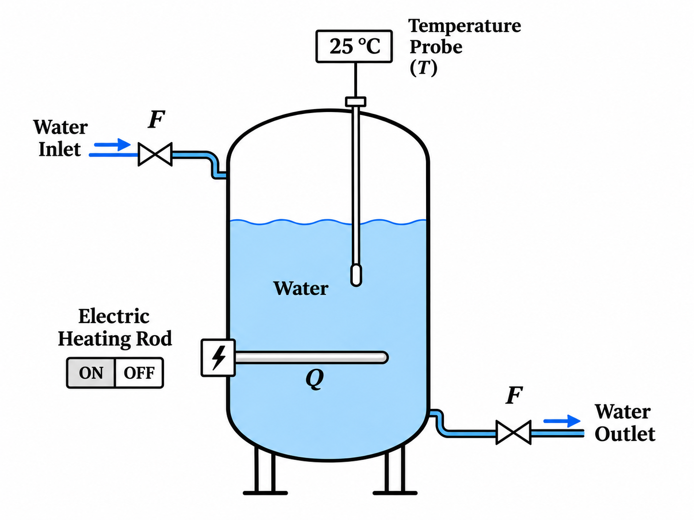
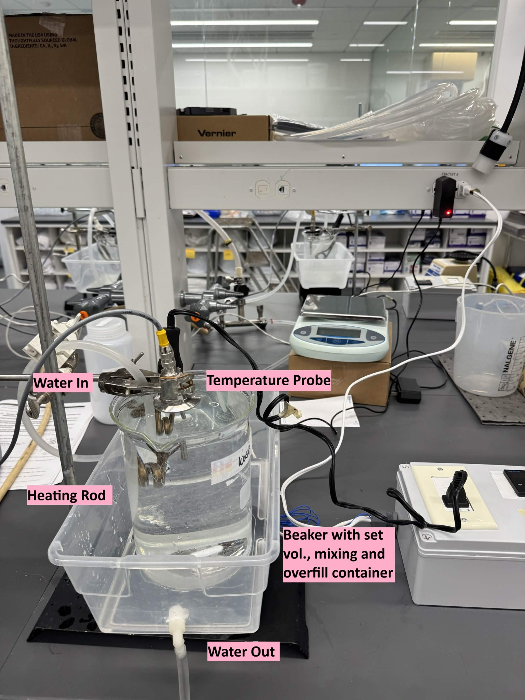
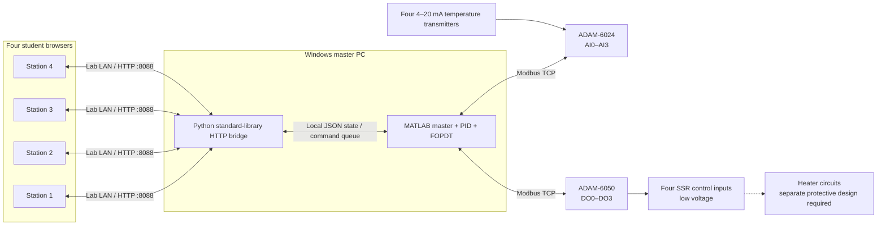

# Four-Station Process Control Laboratory

**MATLAB PID control · thermal digital twin · Modbus TCP · industrial DAQ · browser-based engineering education**

An experimental teaching platform that connects **four independent student browser stations** to a central MATLAB controller. Students explore a first-order thermal digital twin, compare PI/PID tuning strategies, monitor temperature measurements from analog transmitters, and after qualified commissioning run closed-loop heating experiments using industrial I/O.

> [!IMPORTANT]
> **Prototype / educational software - not a safety-rated industrial controller.** Independent hardware overtemperature protection, appropriate electrical disconnects, and a qualified review are essential. See [Safety and security](SECURITY.md) and [Commissioning](docs/COMMISSIONING.md).

## Interface preview

| Digital twin | Live experiment |
|:--:|:--:|
|  |  |

<sub>Images show **offline demonstration readings**, not a live heater test. Additional screens: [student login](assets/student-login.png) · [ZN/IMC tuning](assets/student-tuning.png). For a self-contained interactive sample, download and open [the offline browser preview](demo/offline-browser-preview.html); demo code `123456` is illustrative only.</sub>

## Experimental process and benchtop setup

| Simplified process schematic | Current laboratory apparatus |
|:--:|:--:|
|  |  |

**Process description.** The teaching experiment heats a measured volume of water in a mixed vessel using an immersion heating rod. A temperature probe monitors the water temperature while the controller adjusts heater ON/OFF time (SSR duty cycle) to approach a selected temperature setpoint. Water inlet/outlet connections and a secondary container are included in the physical setup. The diagram is a simplified process illustration, not an as-built piping or electrical drawing.

## Architecture



**Separation of responsibilities:** The Python bridge serves the web GUI, authenticates station sessions, and queues commands; MATLAB alone performs Modbus reads/writes, simulation, PID calculations, and instructor control. Students need only a browser.

## Features

- **4 stations:** AI0/DO0 through AI3/DO3, individually authenticated and instructor-armed.
- **FOPDT digital twin:** heater gain, thermal time constant, dead time, and a configurable cooling disturbance.
- **P / PI / PID:** proportional, integral and derivative actions, 0–100% duty, time-proportioned SSR commands.
- **Tuning comparison:** Ziegler–Nichols PI/PID, conservative IMC PI, manual PID, rule-based fuzzy gain scheduling.
- **Live measurements:** four 4–20 mA analog channels (temperature span must be verified).
- **Separated CSV downloads:** simulation and live views expose different column sets (see limitations below).
- **Instructor console:** arming, software temperature trips, digital reconnection, output OFF commands, station code viewing.

## Quick start (software)

**Master PC:** Windows + MATLAB with Modbus support (project developed against MATLAB R2026b and Industrial Communication Toolbox) + Python 3. No third-party Python packages are required. **Student PCs:** Chrome/Edge or another modern browser on the isolated lab network.

1. Configure the **master Ethernet address to `192.168.0.200`** on the dedicated lab LAN, or update all hardcoded master addresses before starting. This value is a **lab-specific example**, not an automatically detected address. Ensure there is no IP conflict.
2. Verify the intended ADAM module addresses: **ADAM-6024 `192.168.0.20`**, **ADAM-6050 `192.168.0.21`**. The actual addresses and transmitter ranges must match the code.
3. With heater mains power **isolated**, start MATLAB in the repository root and run:

   ```matlab
   Verify_Dual_ADAM           % read-only connectivity and channel test
   master = Start_UnitOps_Lab; % starts the Python bridge and instructor GUI
   ```

4. On the master PC, view station codes using **Open station access codes**. Each generated six-digit code is saved locally under `runtime/` (not tracked by Git).
5. On each student PC, visit **`http://192.168.0.200:8088`**, choose Station 1–4, and sign in using the assigned code.
6. First evaluate the **simulation** without energizing physical outputs. Live use requires separate commissioning of sensors, I/O, protections, and wiring.

Read the full [Installation & launch guide](docs/GETTING_STARTED.md) and [hardware commissioning checklist](docs/COMMISSIONING.md).

## Station mapping

| Station | Analog input (ADAM-6024) | Digital output (ADAM-6050) | Modbus coil |
|---|---|---|---|
| 1 | AI0 | DO0 | 17 |
| 2 | AI1 | DO1 | 18 |
| 3 | AI2 | DO2 | 19 |
| 4 | AI3 | DO3 | 20 |

The mapping describes the **current source configuration**, not a verified wiring diagram.

## Model and tuning

The virtual thermal plant uses a first-order-plus-dead-time approximation:

$$
\tau \frac{dT(t)}{dt} = T_{amb} + K\frac{u(t-L)}{100} + D - T(t)
$$

- `K` is the heater gain in °C per 100% power (default **70 °C**).
- `τ` is the thermal time constant (default **100 s**); `L` is dead time (default **5 s**).
- `D` is an optional equilibrium-shifting cooling disturbance (**-12 °C** in the current implementation).
- `u` is calculated heater demand in **percent**; the *SSR PWM window* (default **20 s**) is a separate output scheduling parameter.

The controller computes PI/PID terms from **setpoint minus temperature**, with saturation and simple integral anti-windup. See [Thermal model](docs/CONTROL_MODEL.md) and [Tuning methods](docs/TUNING.md).

## Repository layout

```text
four-station-process-control-lab/
├── README.md                    # Overview, screenshots, architecture
├── UnitOpsMaster.m              # MATLAB acquisition, control, twin, instructor GUI
├── Start_UnitOps_Lab.m          # Launch master and Python bridge
├── Verify_Dual_ADAM.m          # Read-only Modbus/I-O check
├── Launch_Lab.bat               # Optional Windows launcher
├── bridge.py                    # Python HTTP bridge and session handling
├── www/                         # Student HTML, JavaScript, CSS
├── runtime/                     # Local generated state (ignored by Git)
├── assets/                      # Offline example screenshots
├── demo/                        # Standalone UI preview (no hardware connection)
├── docs/                        # Technical and teaching documentation
├── SECURITY.md                  # Access controls and safe-use scope
├── CHANGELOG.md                 # Version notes
└── .gitignore                   # Excludes credentials and live data
```

The original `.txt` launch, wiring, verification, and change notes are retained for traceability.

## Documentation

| Topic | Link |
|---|---|
| Installation and operation | [Getting started](docs/GETTING_STARTED.md) |
| Control/data flow | [Architecture](docs/ARCHITECTURE.md) |
| FOPDT and discrete PID | [Control model](docs/CONTROL_MODEL.md) |
| ZN, IMC, manual and fuzzy control | [Tuning methods](docs/TUNING.md) |
| I/O, networking and ranges | [Hardware interfaces](docs/HARDWARE.md) |
| Safety checks before live testing | [Commissioning](docs/COMMISSIONING.md) |
| CSV schemas and limitations | [Data and exports](docs/DATA_EXPORTS.md) |
| Known issues, improvements | [Limitations and roadmap](docs/ROADMAP.md) |
| Troubleshooting | [Troubleshooting](docs/TROUBLESHOOTING.md) |

## Project status and scope

**Current package baseline:** the `192.168.0.200` master-IP build from November 2026, including six-digit station logins, a corrected UTC timestamp, browser-mode-specific CSV exports, and instructor GUI layout adjustments. **The underlying source files were not altered for this GitHub packaging.**

Some known limitations: one-second timer can miss very short PWM commands; simulation and live currently **share PID gains/setpoint**; each station retains only a bounded recent history; current CSVs separate *columns* but do not filter inactive samples. See [Roadmap](docs/ROADMAP.md).

